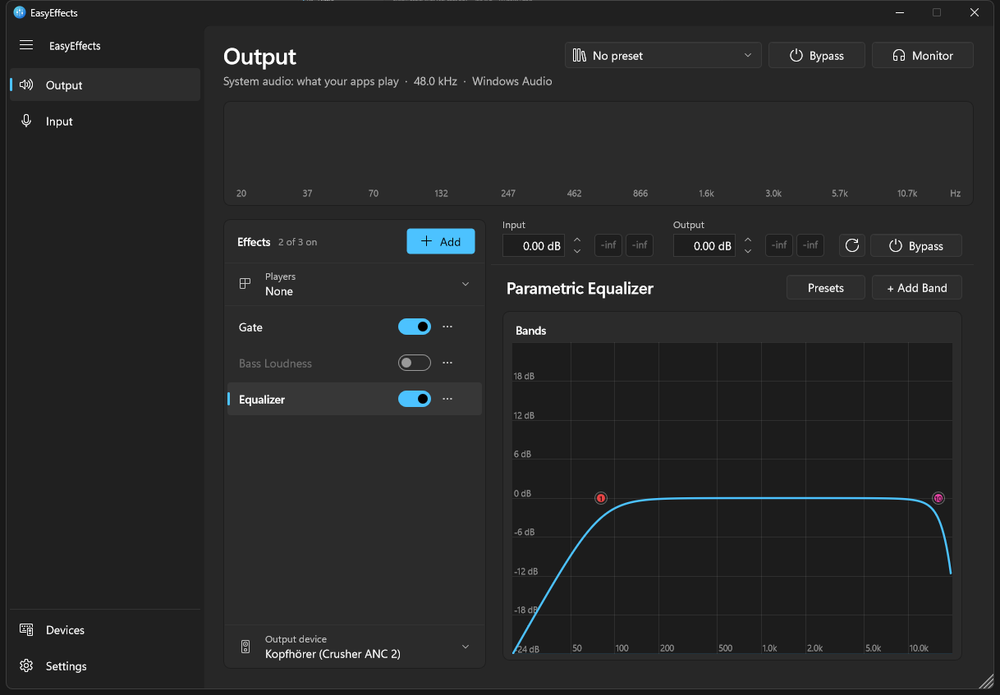
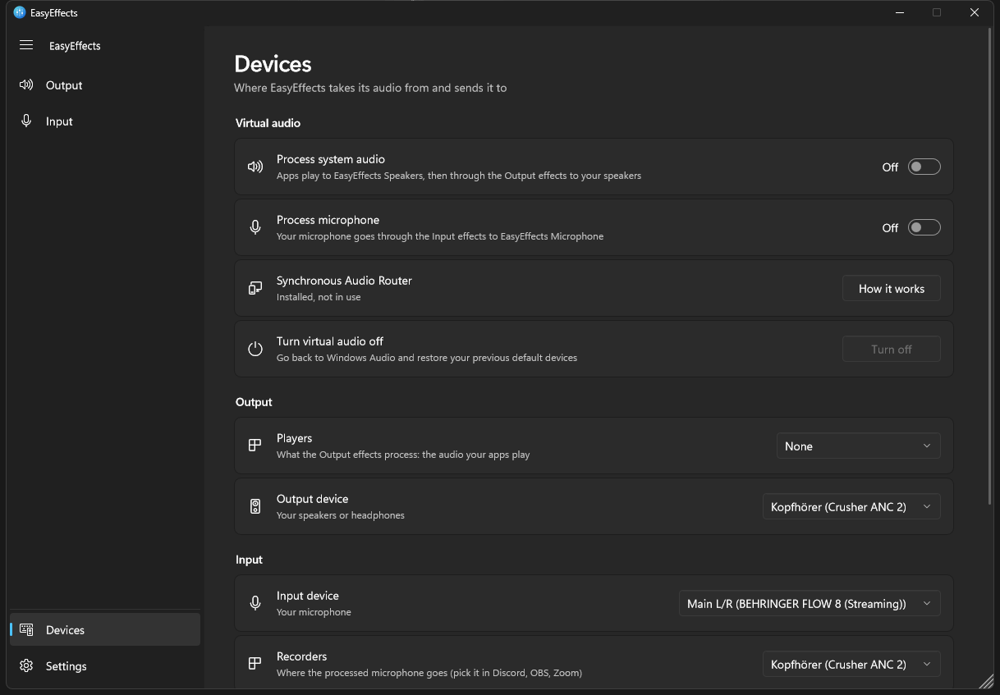
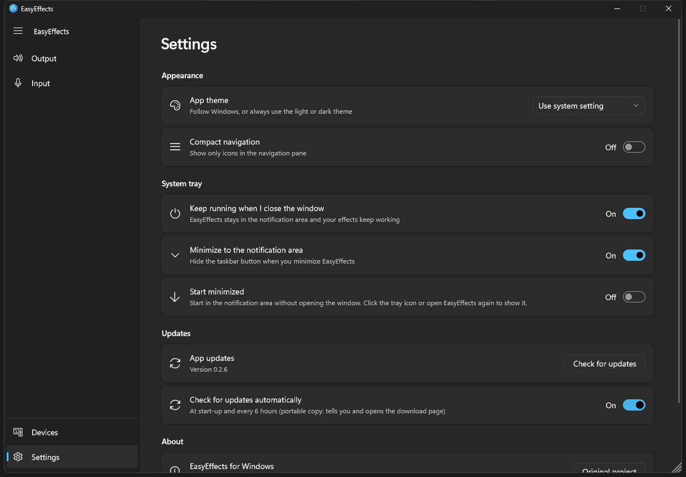

# EasyEffects for Windows

A native Windows audio effects app inspired by [EasyEffects](https://github.com/wwmm/easyeffects) for Linux:
a real-time chain of effects for everything your apps play and for your microphone, with a Windows 11 look.



## Download

Get the latest version from the [Releases](../../releases/latest) page. Every release has two files:

| File | What it is |
|---|---|
| `EasyEffects-Windows-vX.Y.Z-Setup.exe` | **Installer (recommended).** Installs EasyEffects, keeps it up to date by itself, and lets it run with administrator rights without a UAC prompt each time (needed for Virtual Audio). Can start EasyEffects when you sign in. |
| `EasyEffects-Windows-vX.Y.Z-Portable.zip` | **Portable.** Extract anywhere and run `EasyEffects.exe`. It tells you about new versions but does not update itself. |

The files are not code-signed yet, so Windows SmartScreen may warn you the first time: choose
**More info**, then **Run anyway**.

## Status: Alpha

EasyEffects for Windows is under active development. The core works, but you may run into bugs, and
some effects do not yet behave exactly like their Linux counterparts. Bug reports are welcome.

---

## Features

- **Two pipelines, like EasyEffects:** **Output** processes what your apps play, **Input** processes
  your microphone. Each has its own chain of effects, presets and devices.
- **25+ effects:** parametric equalizer, compressor, gate, expander, limiter, maximizer, noise reduction
  (RNNoise), pitch shift, exciter, bass enhancer, de-esser, convolver, crossfeed, reverb, delay and more.
  Add, remove, reorder (drag), switch on/off and reset each effect to its defaults.
- **System-wide audio through Virtual Audio:** with [Synchronous Audio Router](https://github.com/eiz/SynchronousAudioRouter/releases)
  installed, EasyEffects creates its own Windows devices, **EasyEffects Speakers** and **EasyEffects Microphone**,
  and routes them for you (see below).
- **Spectrum analyzer and meters:** live spectrum, input/output level meters for every effect, and a
  dynamics graph for compressor, gate and expander.
- **Presets:** save and load whole chains, or presets for a single effect.
- **Windows 11 design:** navigation pane, light and dark theme (follows Windows), your Windows accent colour.
- **Lives in the notification area:** closing or minimizing keeps EasyEffects running with your effects on.
  The tray icon opens it, turns the Output/Input effects on or off, or quits. It can start minimized.
  Only one copy runs at a time; opening it again shows the running window.
- **Updates itself:** the installed version checks for new releases at start-up and every 6 hours, then
  downloads and installs them in the background and restarts by itself (can be switched off).
- **Low, constant latency between devices:** when an ASIO driver and a Windows Audio device are combined,
  EasyEffects corrects the drift between their clocks continuously, so the delay does not grow over time.

<p>
  
  
</p>

---

## System-wide audio with Virtual Audio (recommended)

Windows has no built-in way for an app to take over all system audio the way PipeWire does on Linux.
EasyEffects therefore hosts [Synchronous Audio Router](https://github.com/eiz/SynchronousAudioRouter/releases)
(SAR, free) through ASIO and uses it to create its own Windows devices:

| Windows device | Type | Route |
|---|---|---|
| **EasyEffects Speakers** | Playback | apps → **Output** effects → your speakers or headphones |
| **EasyEffects Microphone** | Recording | your mic → **Input** effects → Discord, OBS, Zoom, ... |

1. Install SAR once (it is signed and works with Secure Boot on). You do **not** need to configure it.
2. In EasyEffects, open **Devices** and turn on **Process system audio** and/or **Process microphone**. EasyEffects then
   - writes SAR's configuration (your audio interface's ASIO driver as the hardware, plus the two EasyEffects devices),
   - starts SAR and connects both pipelines to the new devices,
   - makes **EasyEffects Speakers** / **EasyEffects Microphone** the Windows default devices.
3. SAR only creates Windows devices for a host running **as administrator**. The installed version starts
   that way automatically; the portable version offers to restart itself as administrator.
4. Turning an option off, choosing **Turn virtual audio off**, or quitting EasyEffects restores your previous
   Windows default devices. The devices exist only while EasyEffects is running.

Your audio interface needs an ASIO driver (most USB interfaces and mixers ship one, e.g. the FLOW 8's *FLOW ASIO Driver*).

### What the installer sets up

Besides the app, the installer registers two Task Scheduler tasks under `\EasyEffects\`:

- **Launch** starts EasyEffects with administrator rights. When you open EasyEffects normally it hands over
  to this task, so there is no UAC prompt.
- **Autostart** (optional, chosen during setup) starts EasyEffects hidden in the notification area when you
  sign in. Turn it on or off later under **Settings > Updates > Start when I sign in**.

Uninstalling removes both tasks.

---

## Custom ASIO routing (Windows Audio and ASIO, both directions)

EasyEffects can also host any ASIO driver (Synchronous Audio Router, FLOW ASIO, your own driver, ...) and
use Windows Audio for the other end of each pipeline:

| Pipeline | Input | Output | Typical use |
|---|---|---|---|
| **Input** (mic) | Windows Audio microphone | ASIO output pair | Windows mic → effects → virtual mic in your ASIO driver |
| **Output** (system) | ASIO input pair | Windows Audio output device | apps or ASIO players → effects → real speakers/headphones |

1. **Devices > Audio engine:** pick your ASIO driver. (ASIO is single-client, so EasyEffects must be the only
   program using it.)
2. **Devices > Input device:** under **Windows Audio microphone**, pick your real microphone. It is read
   through Windows Audio, so it does not have to appear among the ASIO driver's inputs.
3. **Devices > Recorders:** the ASIO output pair your driver exposes as its virtual microphone. Select that
   device in Discord, OBS or Zoom.
4. **Devices > Players:** the ASIO input pair that carries the audio you want to process (e.g. a Synchronous
   Audio Router endpoint).
5. **Devices > Output device:** under **Windows Audio output device**, pick your speakers or headphones.

The same device choices are also on each pipeline page, at the top and bottom of the **Effects** list.

---

## Build from source

You need Windows 10 or 11, Visual Studio 2022 (or newer) with the C++ desktop workload, CMake 3.24+ and Git.

```bash
git clone https://github.com/VoidDeficit/EasyEffects-Windows-Porting.git
cd EasyEffects-Windows-Porting
git submodule update --init --recursive
cmake -B build -G "Visual Studio 17 2022" -A x64 "-DCMAKE_POLICY_VERSION_MINIMUM=3.5"
cmake --build build --config Release --target EasyEffects_Standalone
```

The app is then at `build/EasyEffects_artefacts/Release/Standalone/EasyEffects.exe`.

To package a portable folder or zip into `releases/`:

```powershell
powershell -ExecutionPolicy Bypass -File scripts\package_release.ps1 -NoZip   # folder
powershell -ExecutionPolicy Bypass -File scripts\package_release.ps1          # zip
```

The installer is built from [installer/EasyEffects.iss](installer/EasyEffects.iss) with Inno Setup 6.
Offline tests (currently the clock-drift test for the ASIO / Windows Audio bridge) build with
`-DEE_BUILD_TESTS=ON`.

### Publishing a release

Releases are built by GitHub Actions ([release.yml](.github/workflows/release.yml)). Bump the version in
[`VERSION`](VERSION) (for example `0.2.6` to `0.2.7`) and push it to `master`. The workflow builds the app,
creates the portable zip and the installer, and publishes release `vX.Y.Z` with generated release notes;
installed copies pick it up automatically. Only `master` builds; pushes to other branches start nothing.

---

## License

This project is licensed under the **GNU General Public License v3.0 (GPLv3)**. See [LICENSE](LICENSE).

**External libraries:**
- [JUCE](https://juce.com/) (GPLv3 for open source)
- [RNNoise](https://github.com/xiph/rnnoise) (BSD 3-Clause)
- [SoundTouch](https://codeberg.org/soundtouch/soundtouch) (LGPL)
- Steinberg ASIO interface headers (bundled with JUCE), used under GPLv3 (Steinberg dual-licenses the ASIO SDK under its proprietary licence or GPLv3).
- [Synchronous Audio Router](https://github.com/eiz/SynchronousAudioRouter) is installed separately by the user; EasyEffects only hosts it through ASIO.

The app icon is the EasyEffects icon.

---

## AI-assisted development

**Full disclosure:** most of the C++ architecture, JUCE implementation and DSP porting in this repository
was written with heavy AI assistance (Google Gemini and Anthropic Claude) acting as a pair programmer,
guided and reviewed by a human.

---

*This project is an independent Windows port and is not affiliated with the original EasyEffects developers.*
